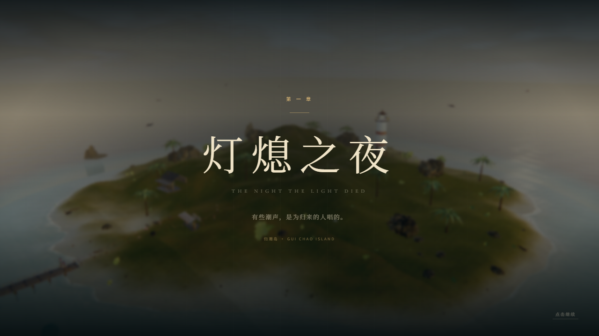
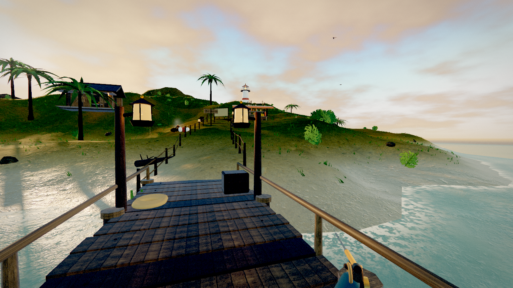

# 潮汐遗歌 · TIDESONG

一段关于潮声、旧灯与归途的 3D 钓鱼冒险。





你回到阔别十年的归潮岛。灯塔熄灭，黑潮上涨，祖父留在海上的最后一首歌正在被某种东西一点点吞掉。修好旧灯，驶过五座岛，钓起那些不该存在的鱼，然后决定这片海以后还要不要唱歌。

## 在线版本

**GitHub Pages：https://real-benguo.github.io/tidesong/**

> v1.2：加入本地账号/多存档、存档导入导出和潮光鱼群；任务卡增加目标方位与距离、任务光柱可穿透山体；补全灯塔基座、平台栏杆、步道栏杆与路灯；提高暗部环境光。修复标题页设置/制作名单被标题层覆盖而无法点击的问题；补强任务场景异常恢复。

仓库：https://github.com/real-benguo/tidesong

## 开始游戏

**Windows：双击 `启动游戏.bat`。**

它会打开 `http://127.0.0.1:4173`。如果浏览器没有自动打开，请手动访问这个地址。

也可以在项目目录运行：

```bash
npm.cmd run build
node server.mjs
```

开发模式：

```bash
npm.cmd install
npm.cmd run dev
```

推荐使用最新版 Chrome / Edge，开启硬件加速，佩戴耳机。本地版本不需要联网；所有环境、鱼、角色、音效与音乐均在本地生成或随包提供。游戏支持浏览器全屏（`F11`、标题菜单、暂停菜单或设置中切换）。

## 本地账号与存档

- 标题页和设置里都有“账号”入口。默认是“归潮者”游客存档，也可以创建带 4–8 位 PIN 的本地账号。
- 每个本地账号有独立存档，适合多个进度共用一台电脑。
- **账号不是云账号**：数据保存在当前浏览器的 `localStorage`，不会上传服务器。换设备、换浏览器或清理站点数据前，请用“导出当前存档”下载 JSON；新环境用“导入存档文件”恢复。
- 自动保存每 20 秒触发一次，并在目标完成、旅行、售卖、结束游戏时保存；暂停菜单也有手动保存。
- 旧的 `tidesong_save_v1` 存档会自动迁移到默认游客账号。

## 操作

| 操作 | 按键 |
| --- | --- |
| 移动 | `W A S D` |
| 疾行 | `Shift` |
| 跳跃 | `Space`（非钓鱼状态） |
| 全屏 | `F11` / `Alt+Enter`，或菜单中的“全屏” |
| 视角 | 鼠标（点击画面锁定指针） |
| 互动 / 交谈 / 拾取 | `E` |
| 钓鱼：蓄力 / 抛竿 | 按住 / 松开鼠标左键 |
| 钓鱼：提竿 | 鱼咬钩时点击左键 |
| 钓鱼：收线 / 泄力 | 按住 / 松开鼠标左键 |
| 猛提 | `Space`（钓鱼状态） |
| 切换鱼饵 | `1` – `6`，或点击右下角鱼饵 |
| 岸边手记 / 图鉴 / 技能 | `Tab` / `J` / `I` |
| 海图 | `M` |
| 暂停 / 返回 | `Esc` |

## 内容

- **五章主线**，39 个剧情目标，47 段对话与记录，约 2–4 小时。
- **五个独立岛屿**：归潮岛、雾苇泽、琥珀环礁、断帆崖、烬潮岛。每座岛有独立的天光、海水、植被、天气与 NPC。
- **36 种鱼**，全部为程序化建模，拥有独立体形、鳍、鳞片纹理、眼睛和游动方式；含 5 位潮主。
- **成长系统**：钓手等级、10 个可叠加技能、鱼竿 / 卷线器 / 钓线三代升级、鱼篓扩容、鱼饵解锁、稀有“潮光变种”与重量纪录。
- **主线 Boss 战**：三段式潮主战，`HOLD / RELEASE / STRIKE` 三种收线指令，断线可免费重试。
- **潮生图鉴**：记录每一种鱼、最重纪录、捕获次数与线索。
- **两个结局**：让潮心继续跳动，或让海彻底安静。
- **完整存档**：自动保存金币、等级、装备、鱼饵、图鉴、主线进度与选择。可在设置里抹去存档。
- **操作与表现**：全屏切换、跳跃与落地扬尘、交互目标柔和高亮、任务目标方位/距离、可穿山体的任务光柱、接触阴影、镜头/地形/道具穿模修正、按岛独立的步道与植被避让。
- **本地账号**：多存档 + PIN + JSON 导入导出，避免“换浏览器就找不到进度”。
- **潮光鱼群**：水面上会出现发光环带；把浮标抛进环带会提升稀有鱼概率，增加钓鱼时的主动选择。
- 无内购、无广告、无联网依赖、无付费素材。

## 技术

- Three.js r180 + Vite 7，纯 WebGL2。
- 自定义海洋着色器（深度、浅滩、浪、泡沫、天空反射）、程序化云层与体积感天光、PBR 地形混合、静态网格合批、实例化草与花。
- 鱼、角色、棕榈、红树、灯塔、船、码头、UI 与全部音乐/音效均为原创或程序化生成；鱼、角色、场景道具不依赖外部模型包。
- 场景接触阴影、按岛步道与道具避让、交互柔光、镜头/地形/道具碰撞修正；近景木构与码头钉、缆绳细节。
- 环境 HDRI 与基础材质来自 Poly Haven（CC0），HDRI 已压缩为 2K 以适合网页加载；字体来自 Google Fonts / Fontsource（OFL）。详见 [CREDITS.md](CREDITS.md)。
- 静态构建可直接发布到 GitHub Pages（`gh-pages` 分支）。

## 存档

按本地账号分开存储：`tidesong_save_v2_<账号 ID>`。设置单独保存。清除浏览器站点数据会删除所有本地账号与存档；重要进度请导出 JSON。设置中的“抹去存档”只删除当前账号的进度。

## 设计参考

《渔力全开 / How to Fish》最值得借鉴的是：**把钓鱼做成一条节奏很快、能立刻看到反馈的循环**——抛、拽、把鱼拉出水面，然后立刻换成钱、装备和下一座岛；鱼饵决定鱼种、图鉴填满、每座岛一个潮主、装备逐岛升级。我们在这些结构上做了原创重组，并把它的短板作为设计约束：

- 用完整主线、NPC 与两种结局替代薄弱的叙事；
- 用可读的收线指令与可重试的潮主战替代“接触伤害”；
- 保留鱼饵、图鉴、重量、纪录、岛屿推进与装备成长，但不做强制刷钱；
- 单人也完整可玩。

参考阅读：[Game8 评测](https://game8.co/reviews/how-to-fish/how-to-fish-review)、[GameLook 报道](http://www.gamelook.com.cn/2026/08/600500/)、[17173 鱼类与鱼饵资料](https://news.17173.com/content/09022026/200928390.shtml)、[360 全岛屿流程](http://360game.360.cn/article/content?id=6a969821f86795ebfff07d78)。

---

**潮汐遗歌 · TIDESONG**  
“有些潮声，是为归来的人唱的。”
